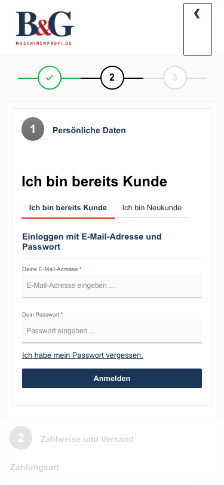

# B&G (maschinenprofi.de staging) — bug report, 2026-11-09

Staging: http://maschinenprofi.de.cloud7-vm254.de-nserver.de
Daily run 2026-11-09: 105 tests — 64 passed, 6 failed, 35 skipped.
All 6 failures come from the 4 bugs below; every bug was confirmed again in today's run (still open).

| # | Bug | Failing tests |
|---|-----|---------------|
| 1 | Error pages (404, 400) never finish loading — Content-Length 736 bytes too large | 2 |
| 2 | Product pages show no description on staging | 2 (desktop + mobile) |
| 3 | Product image thumbnails have no alt text | 1 |
| 4 | Checkout on phones: "Zurück zum Shop" cut off, page scrolls sideways | 1 |

---

## 1. Error pages (404, 400) never finish loading — Content-Length is 736 bytes too large

**Page:** any error page, e.g. http://maschinenprofi.de.cloud7-vm254.de-nserver.de/e2e-not-existing-1 (404) or `/search?search[]=e2e` (400)

**Steps:**
1. Open a URL that doesn't exist, or run `curl -sS -o /dev/null <url>`.

**Expected:** The error page loads completely, like on DinoParts / Würth on the same server.

**Actual:** The HTML that arrives is complete (it ends with `</html>`), but the response header announces 736 bytes more (`Content-Length: 158785`, 158049 bytes sent — `curl: (18) transfer closed with 736 bytes remaining to read`). The browser keeps waiting for the missing bytes: the page stays in "loading", `DOMContentLoaded` never fires, so Shopware's JavaScript (menu flyouts, search suggestions, off-canvas cart) never starts on error pages. Always exactly 736 bytes, on every error page — normal 200 pages are fine. Probably something changes the error page output after the length was set (a plugin / response subscriber).

**Fails:** "Error handling › unknown URL shows a 404 page with a way back", "Product detail page › unknown product URL returns 404".

**Checked:** 2026-11-06, again 2026-11-09 (still open)

---

## 2. Product pages show no description on staging

**Page:** http://maschinenprofi.de.cloud7-vm254.de-nserver.de/bosch-expert-spannungspruefer-exvt1000-17 (same on every product checked)

**Steps:**
1. Open any product page on staging.
2. Scroll below the gallery / buy box.

**Expected:** The "Beschreibung" / "Technische Eigenschaften" section, as on production (https://www.maschinenprofi.de/bosch-expert-spannungspruefer-exvt1000-17).

**Actual:** The CMS block `cms-block-product-description-reviews` is rendered empty (`

`). The description is in the staging data — it appears in `<meta name="description">` and in the JSON-LD — it just isn't rendered.

**Fails:** "Product detail page › shows core product information" (desktop + mobile).

**Checked:** 2026-11-05, again 2026-11-09 (still open)

---

## 3. Product image thumbnails have no alt text

**Page:** http://maschinenprofi.de.cloud7-vm254.de-nserver.de/bosch-expert-spannungspruefer-exvt1000-17

**Steps:**
1. Open the product page on desktop.
2. Inspect the small thumbnail images below the main product image.

**Expected:** The thumbnails have an `alt` attribute (e.g. the product name), like the main image does.

**Actual:** The images in `.gallery-slider-thumbnails` have no `alt`. Screen readers read the file name instead. Affects all products with more than one image.

**Fix:** Add `alt` to the thumbnail images in the theme's gallery template.

**Fails:** "Accessibility › images have an alt attribute".

**Checked:** 2026-11-05, again 2026-11-09 (still open)

---

## 4. Checkout on phones: "Zurück zum Shop" is cut off and the page scrolls sideways

**Page:** http://maschinenprofi.de.cloud7-vm254.de-nserver.de/checkout/register (with a product in the cart), 375 × 812

**Steps:**
1. Add a product to the cart on a phone-sized screen.
2. Go to the checkout.

**Expected:** The header's "Zurück zum Shop" button shows its label; the page fits the screen width.

**Actual:**
- The button (`.header-minimal-back-to-shop-button`) is a 46 × 86 px box with `overflow: hidden`; its text needs 67 px, so only "‹" is visible in an otherwise empty box.
- The page is 4 px wider than the screen (scrollWidth 379 at 375) and scrolls sideways: the `.row` around `.confirm-payment` / `.confirm-shipping` is 383 px wide — a Bootstrap row whose negative margins aren't compensated by a container.

**Fails:** "Responsive layout mobile-375x812 › cart, off-canvas cart and guest checkout fit with a product in the cart".

**Screenshot:** 

**Checked:** 2026-11-05, again 2026-11-09 (still open)

